# Hi, I'm Cangsheng 👋

**Platform Architect** · **AI full-stack & DevOps engineer** · **Open-source developer**

I design and build end-to-end AI applications and developer platforms, spanning Java and Rust backend systems, data tooling, desktop applications, and the DevOps lifecycle from build and delivery to deployment and operations.

---

### 🚀 What I Build

- **AI applications & platforms** — end-to-end products that connect intelligent capabilities with reliable production systems.
- **Data tooling** — local analytics tools built with Rust, Tauri, and Apache DataFusion.
- **Database extensions** — PostgreSQL plugins that bring specialized workflows closer to SQL.
- **DevOps & developer infrastructure** — build, delivery, deployment, and operations workflows, including self-hosted services for reliable package and image distribution.

---

### 🏆 Highlighted Work

- **[EasyDB](https://github.com/shencangsheng/easydb_app)** — A lightweight desktop app for querying local files and MySQL with SQL. Built with **Tauri + Rust + Apache DataFusion**; supports CSV, TSV, text, NDJSON, Excel, Parquet, and datasets from hundreds of MB to several GB. **500+ ⭐** · *让所有数据说同一种“语言”*

- **[Bedtools PostgreSQL Plugin](https://github.com/shencangsheng/pg_bedtools_rs)** — A Rust implementation of a PostgreSQL extension that brings bedtools capabilities into database workflows.

- **[Easy Registry Mirror](https://github.com/shencangsheng/easy-registry-mirror)** — A Docker-based private registry for multiple repository types, with automatic proxy configuration for secure, efficient traffic management.

---

### 📊 GitHub Activity

<table>
  <tbody>
    <tr>
      <td>
        <picture>
          <source media="(prefers-color-scheme: dark)" srcset="./profile/stats-vue-dark.svg">
          <source media="(prefers-color-scheme: light)" srcset="./profile/stats-vue.svg">
          
        </picture>
      </td>
      <td>
        <picture>
          <source media="(prefers-color-scheme: dark)" srcset="./profile/top-langs-vue-dark.svg">
          <source media="(prefers-color-scheme: light)" srcset="./profile/top-langs-vue.svg">
          
        </picture>
      </td>
    </tr>
  </tbody>
</table>

---

### 📫 Reach Me

Open to collaboration and conversations about AI applications, platform architecture, Java, Rust, DevOps, and developer infrastructure.

**Email:** [shencangsheng@126.com](mailto:shencangsheng@126.com)
